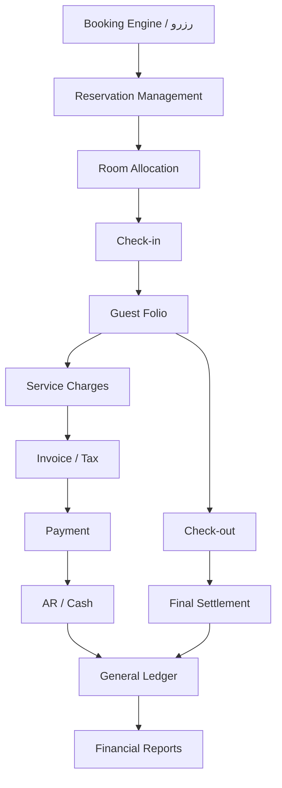
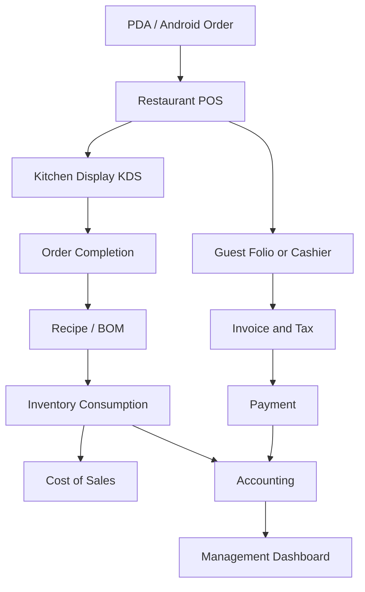
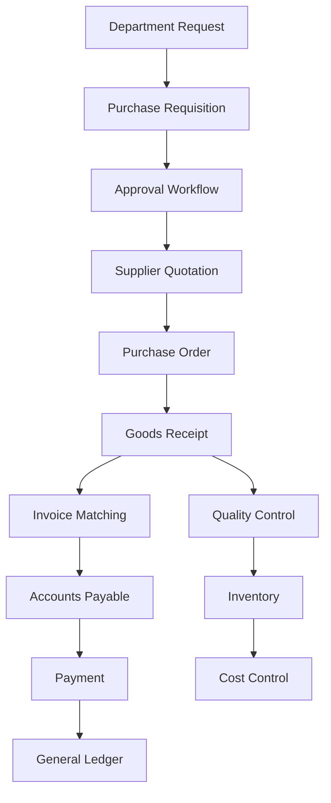
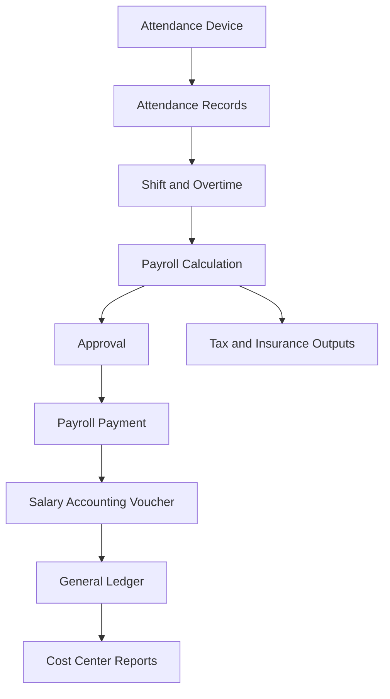

# سند ۰۳ — معماری سیستم

> فاز ۰ — مرجع «چگونه». تصویر کلی: [روابط اجزا](../20-master-workplan/assets/relations.png) | نقشه ذهنی: [mindmap](../20-master-workplan/assets/mindmap.png)

## ۱. تصمیم معماری: Modular Monolith

یک واحد استقرار واحد (NestJS) شامل ماژول‌های دامنه‌ای با مرز سخت‌گیرانه؛ نه ریزخدمت‌های زودهنگام
(هزینه استقرار/مانیتورینگ بالا برای تیم کوچک) نه کد درهم‌بسته (توسعه و فروش تجاری دشوار).
مسیر ارتقا: مرزهای ماژولی + قراردادهای صریح → در آینده جداسازی انتخابی به سرویس مستقل ممکن است.

**قواعد غیرقابل مذاکره:**
1. هر ماژول مالک منطق و داده دامنه خود است؛ هیچ دسترسی مستقیم به جداول ماژول دیگر.
2. ارتباط بین‌ماژولی فقط با: فراخوانی سرویس نسخه‌دار (درون‌پردازشی) یا رویداد دامنه‌ای.
3. رویدادها با الگوی **Transactional Outbox** منتشر و با **Idempotency Key** مصرف می‌شوند.
4. برای هر موجودیت یک **منبع حقیقت واحد**: اتاق→پذیرش، موجودی→انبار، سند→حسابداری.
5. یکپارچگی خارجی فقط از طریق **Integration Hub** با Adapter مستقل به‌ازای هر سرویس/دستگاه.

## ۲. لایه‌ها

1. **کلاینت:** وب Next.js (EN پیش‌فرض/FA-RTL) | اپ کارکنان Flutter | PDA رستوران | کیوسک | پرتال مهمان
2. **دروازه API:** NestJS + OpenAPI نسخه‌دار، احراز هویت، RBAC/ABAC، اعتبارسنجی، Rate-Limit
3. **ماژول‌های دامنه:** iam، settings، i18n/تقویم، audit | پذیرش، رزرو، صندوق، POS/KDS، خانه‌داری،
   انبار، خرید، حسابداری، حقوق، دارایی، مؤدیان، CRM، AI
4. **رویداد و صف:** RabbitMQ + Outbox + مصرف‌کننده تکرارپذیر
5. **داده:** PostgreSQL (منبع حقیقت، تراکنش ACID) | Redis (کش/نشست)
6. **یکپارچگی خارجی:** درگاه/پوز، مؤدیان، ساعت‌زنی A5، OTA، قفل هوشمند، سنسور دما

## ۳. پشته فناوری و قواعد فنی

| لایه | فناوری | نکته |
|---|---|---|
| وب | Next.js + React + TypeScript | SSR برای پرتال عمومی رزرو |
| سرور | NestJS + TypeScript | ماژول‌بندی بومی، DI، OpenAPI خودکار |
| داده | PostgreSQL + Prisma/TypeORM | Decimal/BigInt برای ریال؛ هرگز Float |
| صف | RabbitMQ | رویداد دامنه‌ای، صف پایدار، DLQ |
| موبایل/PDA | Flutter | یک کدبرد: اپ کارکنان/PDA/کیوسک؛ آفلاین + همگام‌سازی |
| تست | Jest + Playwright | سبز بودن CI شرط ادغام |
| رصد | OpenTelemetry + Grafana + Sentry | تأخیر/خطا/تریس از روز اول |
| استقرار | Docker + docker-compose (+ CI/CD GitHub Actions) | استقرار تک‌سرور هتل |

## ۴. جریان‌های مرجع (نسخه Mermaid — از سند کارفرما بخش ۵)

### ۴.۱ رزرو تا گزارش مالی

**قواعد اجرایی:** رزرو تأییدشده ظرفیت را کنترل کند؛ هر رزرو چند اتاق/چند مهمان؛ هر اقامت یک یا چند
فولیو؛ هزینه خدمات فقط از ماژول مالک خدمت؛ پرداخت به تراکنش معتبر متصل؛ تسویه مانده را صفر یا
بدهی مجاز کند؛ خروج مهمان بدون کنترل تسویه نهایی نشود.

### ۴.۲ رستوران تا حسابداری

**قواعد اجرایی:** ثبت سفارش ≠ مصرف قطعی؛ مصرف پس از نهایی‌شدن فروش و تأیید خروج محصول طبق فرمول؛
سفارش لغوشده پیش از تولید مصرف نمی‌سازد؛ برگشت تولیدشده فرایند جدا؛ نسیه به فولیو مهمان؛ فروش و
مصرف شناسه مرجع مشترک داشته باشند.

### ۴.۳ خرید تا پرداخت (سه‌طرفه)

**قاعده:** سفارش خرید + رسید کالا + فاکتور تأمین‌کننده باید با هم تطبیق شوند؛ فاکتور بدون پشتوانه
و پرداخت تکراری ممکن نیست.

### ۴.۴ حقوق تا دفاتر

### ۴.۵ موتور مرکزی سند (نگاشت رویداد → سند)

| رویداد عملیاتی | سند حسابداری (مفهومی — کدینگ نهایی با سیاست هتل) |
|---|---|
| ثبت درآمد اتاق | بدهکار حساب مهمان / بستانکار درآمد اتاق + مالیات |
| دریافت از مهمان | بدهکار صندوق/بانک / بستانکار حساب مهمان |
| خرید کالا | بدهکار موجودی/هزینه / بستانکار تأمین‌کننده |
| مصرف مواد | بدهکار بهای تمام‌شده / بستانکار موجودی |
| فروش غذا | بدهکار دریافتنی / بستانکار درآمد + مالیات |
| استهلاک | بدهکار هزینه استهلاک / بستانکار استهلاک انباشته |
| ثبت حقوق | بدهکار هزینه حقوق / بستانکار پرداختنی مربوط |

## ۵. امنیت (خلاصه — جزئیات docs/12)

OWASP ASVS 5.0 + API Security Top 10 + Zero Trust | MFA نقش‌های حساس | Argon2id | TLS |
RBAC+ABAC جزئی (نمونه حسابدار سند کارفرما: می‌تواند مشاهده/پیش‌نویس/ویرایش/ارسال به تأیید؛
نمی‌تواند خودتأییری/حذف قطعی/تغییر حساب حساس/مشاهده حقوق مدیرعامل) | Audit Trail کامل
(کاربر/زمان/IP/دستگاه/قبل/بعد/دلیل/شناسه) | عدم ذخیره داده کارت | اسکن فایل آپلودی |
بکاپ رمزگذاری‌شده. **اصلاح تصور رایج:** مخفی‌سازی نام جدول/کدگذاری URL به‌تنهایی امنیت نیست؛
کنترل دسترسی سمت سرور و ورودی امن، اصل است.

## ۶. استقرار و پایداری

- **پیش‌فرض:** یک سرور اختصاصی در هتل (Docker Compose: app+db+queue+cache+observability).
- **DR:** بکاپ روزانه رمزگذاری‌شده خارج از سرور + آزمون بازیابی فصلی زیر ۴ ساعت.
- **آفلاین:** PDA/POS صف محلی + همگام‌سازی کنترل‌شده پس از بازگشت شبکه؛ قطع سرویس خارجی هرگز
  عملیات داخلی را متوقف نکند (حالت degrade تعریف‌شده برای هر Adapter).
- **مقیاس:** تک‌شرکتی؛ اضافه‌بار از طریق کش و ایندکس؛ ارتقای آینده به چند‌هتلی از طریق جداکردن
  tenant-id در لایه داده (از ابتدا در طراحی دیده شود، فعال نشود).
