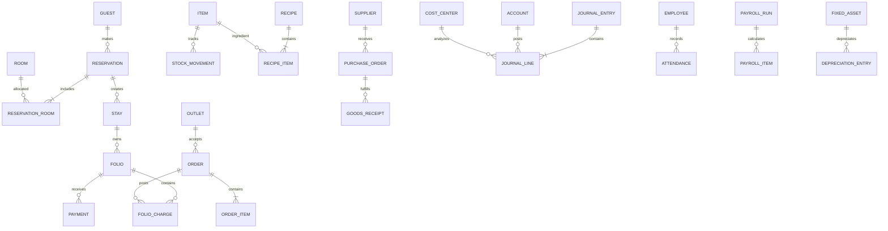

# سند ۰۴ — مدل داده (Data Model)

> فاز ۰ — مرجع طراحی پایگاه داده PostgreSQL. موجودیت‌ها و ER از سند کارفرما (بخش ۱۰) + تکمیل.

## ۱. قواعد الزامی (۱۲ قاعده — بدون استثنا)

1. هر جدول کلید اصلی یکتا دارد؛ شناسه‌های قابل نمایش در API از نوع **UUID** هستند.
2. کلیدهای مالی به عملیات منبع دارای **ارتباط مرجعی (FK)** هستند.
3. **حذف فیزیکی اسناد مالی قطعی ممنوع**؛ اصلاح فقط با سند اصلاحی/برگشت/ابطال کنترل‌شده.
4. ثبت سند حسابداری در **یک تراکنش اتمیک** انجام می‌شود.
5. همه عملیات حساس **Idempotency Key** دارند (درخواست تکراری = ثبت دوباره ممنوع).
6. تاریخ‌ها استاندارد (timestamptz/UTC) ذخیره و در UI به شمسی/میلادی تبدیل می‌شوند.
7. مبالغ **Numeric/BigInt** (کوچک‌ترین واحد ریال) — **ممیز شناور مطلقاً ممنوع**.
8. واحد پول پایه ریال؛ نمایش تومان فقط UI؛ ارز دیگر در صورت نیاز با نرخ تاریخ‌دار.
9. موجودی از **گردش‌ها** (stock_movements) محاسبه/تطبیق می‌شود، نه فقط فیلد مانده.
10. عملیات حساس دارای **تاریخ مؤثر + تاریخ ثبت + دوره مالی** هستند.
11. جداول تاریخچه‌دار از Versioning/Temporal Audit پشتیبانی می‌کنند (زمان‌مؤثر).
12. هر جدول حساس: ستون‌های ردپا (created_by/at, updated_by/at) + حسابرسی تغییرات.

## ۲. دامنه‌ها و جداول اصلی (فهرست اولیه — هر دامنه در فاز خود جزئیات می‌شود)

| دامنه | جداول / موجودیت‌های اصلی |
|---|---|
| کاربران | users, roles, permissions, user_roles, sessions, mfa_devices |
| هتل | hotel_profile, buildings, floors |
| اتاق | room_types, rooms, room_statuses, room_maintenance |
| مهمان | guests, guest_documents, guest_preferences, memberships |
| رزرو | reservations, reservation_rooms, reservation_guests, rate_plans |
| اقامت | stays, checkins, checkouts, registration_cards(امضا) |
| حساب مهمان | folios, folio_charges, folio_adjustments, folio_transfers |
| پرداخت | payments, payment_transactions, refunds, gateway_logs, pos_batches |
| رستوران | outlets, tables, menus, menu_items, orders, order_items, kitchen_tickets |
| آشپزخانه/فرمول | recipes, recipe_versions, recipe_items, portions, yields |
| انبار | warehouses(سلسله‌مراتبی), items, item_units, unit_conversions, stock_movements, stock_counts, wastage |
| خرید | suppliers, quotations, purchase_orders, goods_receipts, quality_checks, invoice_matches |
| حسابداری | accounts, journals, journal_entries(۱۴ فیلد), journal_lines, fiscal_periods, cost_centers |
| هزینه | cost_centers, expenses, budgets, budget_vs_actual |
| حقوق | employees, contracts, attendance, shifts, payroll_runs, payroll_items, loans, deductions |
| دارایی | fixed_assets, depreciation_entries, asset_transfers, maintenance_orders |
| اسناد/گردش | documents, document_versions, workflows, approval_steps, signatures |
| ممیزی | audit_logs, security_events, outbox_events, inbox_events |
| هوش مصنوعی | ai_sessions, ai_tasks, ai_sources, ai_draft_documents |
| یکپارچگی | integration_endpoints, adapters_config, sync_queues |

**ساختار سلسله‌مراتبی انبار (طبق سند کارفرما):** انبار مرکزی → (غذایی: خشک/یخچال/فریزر/سردخانه،
غیرغذایی: شوینده/مصرفی/ملزومات) | انبار شارژ کد (آشپزخانه/رستوران/خانه‌داری) | تجهیزات (ابزارآلات/
قطعات/اموال) | ضایعات (غذایی/غیرغذایی) | اختصاصی (لاندری/مجموعه آبی).

**۱۴ فیلد الزامی سند مالی (journal_entries):** شماره سند یکتا، تاریخ سند، تاریخ ثبت، دوره مالی،
شرح، حساب بدهکار، حساب بستانکار، مبلغ، مرکز هزینه، منبع تولید سند، شماره سند مرجع، کاربر
ثبت‌کننده، کاربر تأییدکننده، وضعیت تأیید (+ پیوست‌ها، سوابق تغییرات، شماره عطف).

## ۳. نمودار روابط موجودیت‌ها (ER — نسخه Mermaid از سند کارفرما)

## ۴. قراردادهای ستونی مشترک

- شناسه: `id UUID PK` + کدهای نمایشی انسانی جدا (مثل شماره سند الگویی: `JV-1405-000123`).
- پول: `amount NUMERIC(20,0)` (ریال صحیح)؛ در صورت نیاز اعشار: `NUMERIC(20,4)` فقط برای کمیت‌ها.
- وضعیت‌ها: enum‌های PostgreSQL با مقدارهای انگلیسی پایدار (نمایش ترجمه‌شده در UI).
- حذف: `deleted_at` (soft) برای داده عملیاتی؛ **اسناد قطعی حتی soft-delete هم ندارند** (ابطال).
- چندزبانه: جدول‌های ترجمه `(entity_id, lang, field)` برای نام‌های چندزبانه (منو، اتاق، انبار).
